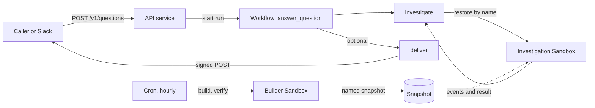
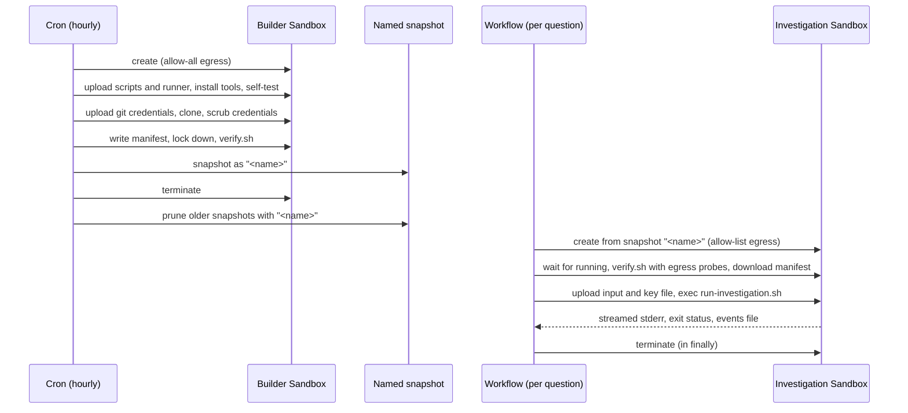

# Walkthrough

Follow one question through the three services, HTTP and Slack adapters,
workflow, Sandbox, runner, and security boundary. Read top to bottom once,
then use the section links as a reference.

To deploy or run the project, start with [QUICKSTART.md](QUICKSTART.md). For
reusable patterns and their implementation locations, see
[TAKEAWAYS.md](TAKEAWAYS.md).

**Contents:**
[Architecture](#architecture) ·
[Repository layout](#repository-layout) ·
[Question API](#the-question-api) ·
[API and Slack](#the-api-service-and-slack-adapter) ·
[Workflow](#the-workflow) ·
[Sandboxes](#sandboxes) ·
[Runner](#the-runner) ·
[Security boundary](#the-security-boundary)

## Architecture

The system has three services, all declared in [`render.yaml`](../render.yaml) as one project with a `production` environment in Oregon.

**API** (`codebase-researcher-api`, web service) accepts questions over HTTP and, when configured, listens for Slack mentions. It starts a workflow run for each question and returns immediately. For Slack, it acknowledges the event first and only then reads the thread and starts the run, so Slack's 3-second deadline is met no matter how long the thread is or how slowly the Render API answers.

**Workflow** (`codebase-researcher-workflow`, Render Workflow) defines one parent task, `answer_question`, and two subtasks, `investigate` and `deliver`. The parent starts `investigate`, which restores a Sandbox and runs the agent in it, turns the outcome into a reply, and, if the caller supplied a callback URL, starts `deliver` to POST the signed reply there.

**Cron** (`codebase-researcher-snapshots`, hourly) builds and verifies a named
repository snapshot. The workflow restores the newest snapshot under that
name; the [Sandbox lifecycle](#the-lifecycle) covers build and retention.



### The question is the unit of work

The core abstraction is a *question*: a transcript, an optional callback, and optional metadata, answered asynchronously. Slack is one consumer, but the same API serves any caller: a CLI, a web dashboard, a CI pipeline, or another bot. The Slack adapter translates between Slack's event model and the question API; the workflow and everything below it know nothing about Slack.

Slack-specific SDK calls, rate limits, and formatting stop at the adapter.
Leave its environment variables unset to disable Slack without changing the
pipeline. To add another channel, see
[QUICKSTART.md](QUICKSTART.md#add-a-channel-beyond-slack).

Each question gets a fresh Sandbox restored from the immutable snapshot. The
[per-question lifecycle](#one-fresh-sandbox-per-question) explains the
isolation, cleanup, and roughly 15-second restore cost.

### Why the cron rebuilds every hour

The cron runs every hour whether or not the repositories changed. This is simpler than webhook-driven builds and avoids the failure modes of webhook delivery: missed events, duplicate events, and webhook secret rotation. An hourly cadence is frequent enough that investigations see commits within an hour of landing. It also keeps snapshots from expiring (Render's snapshot retention is time-based), so the service stays available without anyone monitoring snapshot age.

Building unconditionally means some builds are redundant. That is inexpensive: a build takes about 5 minutes on a standard-plan cron that bills only while it runs, and the two-snapshot retention window means at most one redundant snapshot exists at a time.

## Repository layout

```
config.ts                     # what to investigate: name, repos, git credentials, reply labels, snapshot name
prompt.md                     # domain section of the agent's system prompt (yours to edit)
render.yaml                   # Blueprint: one project, three services
.env.example                  # every env var the services read, with comments
package.json                  # scripts: start:api, start:workflow, refresh, typecheck, test
pnpm-workspace.yaml           # pnpm settings (which dependencies may run build scripts)
tsconfig.json                 # strict TypeScript; .ts imports run directly under tsx
vitest.config.ts              # test discovery; files run serially
.node-version                 # Node major version for Render and CI
.github/workflows/ci.yml      # typecheck and test; validates render.yaml when a Render key is configured
docs/
  QUICKSTART.md               # deploy, configure, run locally, add a channel
  WALKTHROUGH.md              # this document
  TAKEAWAYS.md                # patterns worth reusing in your own project
examples/
  hello-sandbox.ts            # minimal Sandbox round trip: create, wait, upload, exec, download, terminate
src/
  api.ts                      # API service entry: Hono server for /v1/questions, /healthz, and the Slack routes
  workflow.ts                 # workflow service entry: env config, timeout math, task registrations
  cron.ts                     # cron service entry: rebuilds the snapshot, logs one snapshot_refresh line
  tasks.ts                    # task bodies: answer_question, investigate, deliver; run classification
  question.ts                 # public API contract: transcript limits, callback, metadata, StartQuestion, Reply
  investigation.ts            # internal transcript, investigation result and evidence schemas, evidence URLs
  manifest.ts                 # repository manifest (what a sandbox contains) and repository profile schemas
  bot-config.ts               # defineConfig: validates config.ts and applies REPOS / SNAPSHOT_NAME overrides
  callback.ts                 # callback signing and verification, constant-time compare
  log.ts                      # createLog: one JSON object per line
  util.ts                     # env blank-value filter, error message helper
  raw.d.ts                    # types for `import text from "./file.md?raw"`
  slack/
    routes.ts                 # mountSlackRoutes: /slack/events and /slack/deliver
    events.ts                 # Slack request signature check, Events API parsing
    client.ts                 # Web API client, reactions, thread reads, idempotent reply posting
    transcript.ts             # thread to transcript, fitting long threads into the API's limits
    format.ts                 # Reply to Block Kit, mrkdwn escaping and truncation
  sandbox/
    index.ts                  # configureSandboxes: picks Render or local sandboxes from the environment
    interface.ts              # the Sandbox contract both providers implement, runner output parser, git helper
    local.ts                  # local sandboxes over your own checkouts (no isolation; development and tests)
    runner-bundle.ts          # bundles src/runner and its packages into one self-contained runner.mjs
    render/
      config.ts               # Render env config, network policy, workspace resolution
      client.ts               # SandboxClient: paced, retrying wrapper around the SDK's Sandbox API
      sandbox.ts              # in-sandbox paths, verification, opening a sandbox, running an investigation
      snapshot.ts             # snapshot build pipeline: resolve heads, build, prune
  runner/
    main.ts                   # runner entry: arguments, credentials, input, self-test, starts the session
    protocol.ts               # host/runner contract: RunnerInput, RunnerEvent, Usage, RUNNER_EXIT
    providers.ts              # model provider to API key env var map
    model.ts                  # Pi model catalog, supported providers, token budgets
    events.ts                 # the JSONL event emitter (with redaction), usage and preview helpers
    session.ts                # agent session: system prompt, tools, turn loop, submission reminder
    tools.ts                  # read-only shell policy; the read, ls, and bash tools
    submit.ts                 # submit_investigation: validates every citation against the checkout
    faux.ts                   # deterministic --faux mode for running without a model
    core-prompt.md            # core section of the system prompt (bundled into the runner)
sandbox-runtime/              # copied into the builder sandbox; the top-level scripts stay in the snapshot
  install-tools.sh            # ensures git, ripgrep, coreutils timeout, and Node >= 22
  as-runner.sh                # runs a command as the unprivileged user with a minimal environment
  run-investigation.sh        # runs the runner once under coreutils timeout; writes events and exit status
  verify.sh                   # checks tools, credentials, manifest, permissions, dumpability, egress
  build/                      # builder-only; deleted before the snapshot
    git-credential-staged.sh  # git credential helper that reads staged per-host token files
    scrub-credentials.sh      # fails the build if a token leaked, then deletes the staged credentials
test/
  api.test.ts                 # auth, request validation, question ids, polling, callback signatures
  slack.test.ts               # Slack parsing, signatures, routes, transcripts, formatting
  tasks.test.ts               # answer_question, deliver, investigate, config loading
  evidence.test.ts            # filterEvidence and evidence URLs
  cron.test.ts                # refreshSnapshot outcomes
  sandbox-local.test.ts       # local sandboxes end to end
  sandbox-render.test.ts      # Render sandboxes against a fake Sandbox API, including build step ordering
  sandbox-runtime.test.ts     # the shell scripts in sandbox-runtime/, run locally
  runner.test.ts              # the bundled runner: credentials, limits, shell policy, tools
  runner-live.test.ts         # live smoke test against a real model (skipped without LIVE_MODEL_PROVIDER)
  fakes.ts, helpers.ts        # fake Slack and Sandbox APIs, temporary git repositories
  fixtures/fake-runner.mjs    # stand-in runner that follows the runner's CLI contract
```

`.scratch/` (gitignored) holds local checkouts, local sandbox scratch directories, and the locally bundled runner during development.

### Shared modules and what depends on what

The types are split by audience, so each service imports only the contract it needs:

- [`src/question.ts`](../src/question.ts) is the public contract: the transcript shape `POST /v1/questions` accepts (at most 200 messages of at most 8,000 characters), the callback and metadata schemas, the `StartQuestion` function type shared by the HTTP route and the Slack adapter, and the `Reply` the workflow returns.
- [`src/investigation.ts`](../src/investigation.ts) is what the runner and workflow exchange internally: the internal transcript (with `ts`, `user_id`, `is_agent`), the `InvestigationResult` union of `FinalAnswer` and `NeedsClarification`, the `Evidence` schema, and `buildEvidenceUrl`, which turns a citation into a GitHub, GitLab, Bitbucket, or templated link.
- [`src/manifest.ts`](../src/manifest.ts) describes a Sandbox's contents: a `RepoManifest` lists each repository's name, branch, full commit, path, and optional clone URL and link style. `RepoProfile` is the configured list before heads are resolved.
- [`src/bot-config.ts`](../src/bot-config.ts) defines `defineConfig`, which [`config.ts`](../config.ts) calls. It validates the config at import time, defaults `gitCredentials` to `GITHUB_TOKEN` for `github.com`, and lets `REPOS` and `SNAPSHOT_NAME` override the repo list and snapshot name.
- [`src/runner/protocol.ts`](../src/runner/protocol.ts) is the contract between the workflow and the runner process (see [The runner](#the-runner)).
- [`src/runner/providers.ts`](../src/runner/providers.ts) maps each Pi provider to its API key env vars. The workflow uses it to find the key to send; the runner uses it to scrub every provider's vars from its environment.
- [`src/log.ts`](../src/log.ts) gives every service the same logger. `createLog(base)` writes one JSON object per line, `{ level, msg, ...base, ...fields }`, with an optional `event` field naming the event for searches and alerts. `Error` values serialize to `{ name, message }`, and `child(fields)` adds fields to every later line. The workflow tasks create loggers tagged with `task`, and the `SandboxClient` receives one so it can log cleanup and prune failures without throwing.
- [`src/util.ts`](../src/util.ts) holds `present`, which drops blank env values before parsing. A `sync: false` variable left empty in the Render Dashboard arrives as `""`, and it should mean "unset, use the default", not "invalid".

## The question API

All `/v1/*` routes require `Authorization: Bearer <API_TOKEN>`; a missing or wrong token gets `401`. `GET /healthz` is unauthenticated and returns `ok`.

### Start a question

```bash
curl -X POST https://codebase-researcher-api.onrender.com/v1/questions \
  -H "Authorization: Bearer $API_TOKEN" \
  -H "Content-Type: application/json" \
  -H "Idempotency-Key: ticket-4821" \
  -d '{"transcript": [{"text": "Where is workspace selection validated?"}]}'
```

Response (`202`):

```json
{"id": "trn-abc123def456.Kx9mZ7..."}
```

The request body accepts:

- `transcript` (required): an array of 1 to 200 messages, oldest first. Each has `text` (string, at most 8,000 characters), optional `author` (string), and optional `is_agent` (boolean; mark the bot's own earlier replies so a follow-up reads as a conversation). The agent treats the most recent human message as the question.
- `callback` (optional): `{ "url": "https://...", "secret": "<16 to 256 characters>" }`. The URL must be HTTPS; in local dev mode, `http://localhost` and `http://127.0.0.1` are also accepted.
- `metadata` (optional): an object of at most 16 keys whose values are strings, numbers, or booleans. It is echoed back in the callback, so use it to correlate callbacks with your requests.

An invalid body gets `400` with `{"error": "<description of every problem>"}`. If starting the workflow run fails or takes longer than 5 seconds, the request fails with `500`.

The optional `Idempotency-Key` header is passed to Render when starting the run, so retrying a request with the same key doesn't start a second run.

### Poll for the result

```bash
curl https://codebase-researcher-api.onrender.com/v1/questions/trn-abc123def456.Kx9mZ7... \
  -H "Authorization: Bearer $API_TOKEN"
```

While the run is pending, running, or paused:

```json
{"id": "trn-abc123def456.Kx9mZ7...", "status": "running"}
```

When it has completed:

```json
{
  "id": "trn-abc123def456.Kx9mZ7...",
  "status": "completed",
  "trace_id": "trn-abc123def456",
  "reply": {
    "kind": "answer",
    "traceId": "trn-abc123def456",
    "result": {
      "status": "final_answer",
      "answer": "...",
      "confidence": "high",
      "observed_in_code": ["..."],
      "inferred_behavior": ["..."],
      "not_established": ["..."],
      "evidence": [
        {
          "repository": "owner/repo",
          "commit": "3f9c2a1e8b7d6c5f4a3b2c1d0e9f8a7b6c5d4e3f",
          "path": "src/file.ts",
          "start_line": 10,
          "end_line": 25,
          "url": "https://github.com/owner/repo/blob/3f9c2a1e8b7d6c5f4a3b2c1d0e9f8a7b6c5d4e3f/src/file.ts#L10-L25"
        }
      ],
      "suggested_owner": "...",
      "escalation_question": "..."
    },
    "model": "claude-opus-5",
    "manifestCreatedAt": "2026-10-08T12:00:00.000Z"
  }
}
```

`trace_id` is the `answer_question` run ID; find the run under the workflow service's task runs in the Dashboard. Evidence `commit` is always the full SHA from the Sandbox's manifest, and `url` is built by trusted code from the configured link style, never by the model (see [`filterEvidence`](#evidence-filtering)).

The `reply` is one of three kinds, defined in [`src/question.ts`](../src/question.ts):

```ts
export type Reply =
  | { kind: "answer"; traceId: string; result: FinalAnswer; model?: string; manifestCreatedAt?: string }
  | { kind: "clarification"; traceId: string; result: NeedsClarification }
  | { kind: "failure"; traceId: string; reason: string };
```

- `answer`: `result` is a final answer, as above. `manifestCreatedAt` says how fresh the repositories were.
- `clarification`: `result` is `{ "status": "needs_clarification", "question": "...", "why_needed": "..." }`. Ask the user, append their answer to the transcript (with the clarification marked `is_agent: true`), and post a new question.
- `failure`: `reason` is a sentence safe to show users, such as "the investigation hit the 15-minute limit". It never contains stack traces or secrets. [The workflow](#failure-classification) lists every reason.

Most failures arrive this way, as a `completed` run with a `failure` reply, because `answer_question` catches errors and turns them into replies. A `failed` status means the workflow run itself failed or was canceled (for example, it hit its own timeout):

```json
{"id": "...", "status": "failed", "error": "task failed"}
```

### Question IDs are signed

A question ID is `<task run ID>.<MAC>`, where the MAC is the first 22 characters of the base64url HMAC-SHA256 of `question-id:<run ID>` keyed with `API_TOKEN` ([`toQuestionId`](../src/api.ts)). `GET` returns `404` for any ID whose MAC doesn't match, so the API token can't be used to read other workflow runs in the workspace, only the ones this API started. It also returns `404` when Render no longer has the run. Rotating `API_TOKEN` invalidates every outstanding question ID.

### Callback format

If the question included a `callback`, the `deliver` subtask POSTs the reply to the URL with these headers:

- `Content-Type: application/json`
- `X-Researcher-Timestamp`: Unix time in seconds.
- `X-Researcher-Signature`: `v1=<hex HMAC-SHA256(secret, timestamp + "." + body)>`.

The body is JSON:

```json
{"trace_id": "trn-abc123def456", "reply": { "kind": "answer", "...": "..." }, "metadata": {"ticket": 4821}}
```

Any non-2xx response, network error, or 10-second timeout counts as a failed attempt. `deliver` retries up to 8 times, waiting 2 seconds and doubling each time, so a receiver should be idempotent: key on `trace_id`. A delivery that fails every attempt is logged (`deliver_failed`), and the reply is still available from `GET /v1/questions/:id`.

Verify the signature against the raw request body, before parsing it. In Node:

```ts
import { createHmac, timingSafeEqual } from "node:crypto";

function verify(secret: string, signature: string, timestamp: string, body: string): boolean {
  const ts = Number(timestamp);
  if (!Number.isFinite(ts) || Math.abs(Date.now() / 1000 - ts) > 5 * 60) return false;
  const expected = `v1=${createHmac("sha256", secret).update(`${timestamp}.${body}`).digest("hex")}`;
  return expected.length === signature.length && timingSafeEqual(Buffer.from(expected), Buffer.from(signature));
}
```

Receivers written in TypeScript inside this repository can call [`verifyCallback`](../src/callback.ts) instead, which does the same check with the same 5-minute tolerance.

Callback secrets travel in workflow task input, which is visible in the Render Dashboard. Derive a secret per question (as the Slack adapter does, below) rather than reusing one long-lived secret, so a leaked secret is good for one question only.

## The API service and Slack adapter

### `src/api.ts`

[`src/api.ts`](../src/api.ts) is split into a testable app and a small server block. `createApp(deps)` builds the Hono app from its dependencies:

- `apiToken` for bearer auth and question ID signing,
- `startQuestion` and `getTaskRun`, the two calls into Render Workflows,
- `isLocalDev`, which relaxes the callback URL rule to allow `http://localhost`,
- `log`.

Tests pass fakes for all of them; nothing in `createApp` talks to Render directly. The routes are the ones described in [The question API](#the-question-api). Unexpected errors are logged as `request_failed` and returned as a plain `500`.

The block at the bottom runs only when the file is executed directly (`pnpm start:api`), not when tests import it. It parses the environment with `loadEnv`, creates a `Render` client (pointed at the local workflow dev server when `RENDER_USE_LOCAL_DEV` or `RENDER_LOCAL_DEV_URL` is set, otherwise authenticated with `RENDER_API_KEY`), and defines:

- `startQuestion`: `render.workflows.startTask(taskSlug, [input], { idempotencyKey, signal })`. The task slug is `WORKFLOW_TASK_SLUG`, or `<WORKFLOW_SLUG>/answer_question`; the Blueprint fills `WORKFLOW_SLUG` from the workflow service with `fromService`.
- `getTaskRun`: `render.workflows.getTaskRun(id)`.

It mounts the Slack routes when both `SLACK_SIGNING_SECRET` and `SLACK_BOT_TOKEN` are set and a public URL is known (`PUBLIC_URL`, or `RENDER_EXTERNAL_URL`, which Render sets); without a public URL it logs `slack_disabled` and serves only the API. The server binds to `0.0.0.0:$PORT` and closes on `SIGTERM`, exiting after 5 seconds at most.

`StartQuestion` is declared once in [`src/question.ts`](../src/question.ts) and shared by the HTTP route and the Slack adapter. The adapter calls it directly, in process, so a Slack mention doesn't make an extra HTTP hop or need the API token.

### `src/slack/`

The adapter is five files, mounted by `mountSlackRoutes(app, slackDeps, { startQuestion, log })` in [`routes.ts`](../src/slack/routes.ts):

| File | Responsibility |
|---|---|
| [`events.ts`](../src/slack/events.ts) | Verifies Slack's `v0` request signature (5-minute tolerance) and parses an Events API body into a URL verification, a human `app_mention`, or something to ignore |
| [`client.ts`](../src/slack/client.ts) | Wraps `@slack/web-api`: bot identity, reactions, paginated thread reads, idempotent reply posting |
| [`transcript.ts`](../src/slack/transcript.ts) | Turns a thread into a transcript and fits it into the question API's limits |
| [`format.ts`](../src/slack/format.ts) | Renders a `Reply` as Block Kit, escaping model-written text |
| [`routes.ts`](../src/slack/routes.ts) | The two HTTP routes, and the work started after a mention is acknowledged |

**A mention arrives at `/slack/events`.** The route verifies the signature over the raw body, answers Slack's `url_verification` challenge, and ignores everything except `app_mention` events from humans. A mention from a bot, including this one, never starts a question; [`isFromBot`](../src/slack/events.ts) recognizes our own bot user from the event's `authorizations` without an API call. Mentions in channels not listed in `ALLOWED_CHANNEL_IDS` are logged as `mention_ignored` and dropped; `*` allows every channel, and an empty list logs `slack_no_channels` at startup because every mention would be ignored.

The route then returns `200` immediately and starts `startMention` in the background. Slack retries any event it doesn't see acknowledged within 3 seconds, and reading a long thread or starting a run can take longer than that. A retry (`X-Slack-Retry-Num`) is handled like the original: it's logged as `slack_retry`, and because the run is started with the Slack event ID as its idempotency key, it doesn't start a second run.

**`startMention` turns the mention into a question:**

1. React with `eyes`, so the user knows the bot saw it. A failure here is logged (`eyes_failed`) and doesn't stop the question.
2. Read the whole thread with [`fetchTranscript`](../src/slack/transcript.ts): every message, oldest first (Slack `ts` values are compared as seconds and microseconds, because they exceed float precision), with this bot's own replies marked `is_agent` and mentions of the bot stripped from the text. A follow-up is just another mention in the same thread; the agent gets the whole conversation again.
3. Fit the thread into the API's limits with [`fitTranscript`](../src/slack/transcript.ts) instead of letting the question fail: a thread over 200 messages keeps the opening message and the most recent ones, and a message over 8,000 characters (usually a pasted log) is cut. Both leave a note in the text, so the agent knows what it didn't see.
4. Call `startQuestion` with a callback to `<public URL>/slack/deliver`, a callback secret of `HMAC-SHA256(SLACK_CALLBACK_KEY, event ID)`, metadata `{ channel, thread_ts, mention_ts, event_id }`, the event ID as the idempotency key, and a 10-second timeout. The timeout is longer than the HTTP route's 5 seconds because nobody is waiting on this request; Slack was already answered.

If any of steps 2 to 4 fails, the adapter logs `task_start_failed`, posts a failure reply in the thread, and swaps `eyes` for `warning`, so the user isn't left waiting on a question that never started.

**The reply arrives at `/slack/deliver`.** The route reads `metadata.event_id` from the body, derives the same secret, and verifies the signature with [`verifyCallback`](../src/callback.ts). Deriving the secret from the event ID means the adapter stores nothing between the mention and the reply, and a leaked secret works for one question only. `SLACK_CALLBACK_KEY` is generated by the Blueprint; if it's unset, the adapter falls back to `API_TOKEN`. Rotating the key while questions are running makes their callbacks fail with `401`.

The route then posts the formatted reply in the thread and swaps `eyes` for `white_check_mark` (an answer or a clarification) or `warning` (a failure). Posting is idempotent: [`postReply`](../src/slack/client.ts) tags each message with Slack message metadata (`researcher_reply`, with the trace ID) and first looks for an existing message with that tag. That makes retries safe. The Web API client is created with Slack's own retries turned off and rate-limited calls rejected, so a failed post surfaces as a `500` from `/slack/deliver`, and the workflow's `deliver` subtask retries the whole callback, which then finds or posts the message exactly once.

[`formatReply`](../src/slack/format.ts) escapes `&`, `<`, and `>` in everything the model wrote, which also defuses `<!channel>` and `<@U…>` pings the model might produce, and truncates to Slack's 3,000-character section limit without leaving half an entity, link, or surrogate pair at the cut. The owner and escalation-question headings, and the team that failure messages tell users to contact, come from `labels` in `config.ts`.

Any other channel follows the same four steps: acknowledge the platform's event, build a transcript, start a question with a per-event callback secret and routing metadata, and render the reply when the callback arrives. The quickstart's [Add a channel beyond Slack](QUICKSTART.md#add-a-channel-beyond-slack) summarizes the integration choices.

### Example: Discord adapter

This is an untested starting point for a `/ask question:<text>` command. Before
using it, confirm Discord's current acknowledgement deadline, interaction-token
lifetime, signature format, and response limits in Discord's documentation.
Register the command and set the Interactions Endpoint URL to
`https://<your-api>/discord/interactions`.

The example returns a deferred response and later edits it through the
interaction webhook. A slow investigation can outlive an interaction token;
for that case, post to the channel with a bot token instead.

Saved as `src/discord.ts`:

```typescript
import { createHmac, createPublicKey, verify } from "node:crypto";
import type { Hono } from "hono";
import { verifyCallback } from "./callback.ts";
import type { Log } from "./log.ts";
import { MESSAGE_MAX_CHARS, type Reply, type StartQuestion } from "./question.ts";
import { errorMessage } from "./util.ts";

type DiscordDeps = { publicKey: string; appId: string; callbackKey: string; publicUrl: string };

const ED25519_SPKI_PREFIX = Buffer.from("302a300506032b6570032100", "hex");
function verifyDiscord(publicKeyHex: string, signature: string | undefined, timestamp: string | undefined, body: string): boolean {
  if (!signature || !timestamp) return false;
  const key = createPublicKey({
    key: Buffer.concat([ED25519_SPKI_PREFIX, Buffer.from(publicKeyHex, "hex")]),
    format: "der",
    type: "spki",
  });
  return verify(null, Buffer.from(timestamp + body), key, Buffer.from(signature, "hex"));
}

const callbackSecret = (key: string, interactionId: string) =>
  createHmac("sha256", key).update(interactionId).digest("hex");

function toDiscord(reply: Reply): string {
  const text =
    reply.kind === "answer"
      ? [reply.result.answer, ...reply.result.evidence.map((e) => `<${e.url}>`)].join("\n")
      : reply.kind === "clarification"
        ? reply.result.question
        : `I couldn't complete this investigation: ${reply.reason}. Trace ${reply.traceId}`;
  return text.length > 2000 ? `${text.slice(0, 1999)}…` : text;
}

export function mountDiscordRoutes(
  app: Hono,
  deps: DiscordDeps,
  { startQuestion, log }: { startQuestion: StartQuestion; log: Log },
) {
  app.post("/discord/interactions", async (c) => {
    const body = await c.req.text();
    if (
      !verifyDiscord(
        deps.publicKey,
        c.req.header("x-signature-ed25519"),
        c.req.header("x-signature-timestamp"),
        body,
      )
    ) {
      return c.text("invalid signature", 401);
    }
    const interaction = JSON.parse(body);
    if (interaction.type === 1) return c.json({ type: 1 });

    const question = interaction.data?.options?.find(
      (option: { name: string }) => option.name === "question",
    )?.value;
    void startQuestion(
      {
        transcript: [{
          text: String(question ?? "").slice(0, MESSAGE_MAX_CHARS),
          author: interaction.member?.user?.id ?? interaction.user?.id,
        }],
        callback: {
          url: `${deps.publicUrl}/discord/deliver`,
          secret: callbackSecret(deps.callbackKey, interaction.id),
        },
        metadata: { interaction_id: interaction.id, token: interaction.token },
      },
      { idempotencyKey: interaction.id, signal: AbortSignal.timeout(10_000) },
    ).then(
      (run) => log.info("task started", {
        event: "task_started",
        interaction_id: interaction.id,
        run_id: run.id,
      }),
      (err: unknown) => log.error("task start failed", {
        event: "task_start_failed",
        interaction_id: interaction.id,
        error: errorMessage(err),
      }),
    );
    return c.json({ type: 5 });
  });

  app.post("/discord/deliver", async (c) => {
    const raw = await c.req.text();
    const { reply, metadata } = JSON.parse(raw) as {
      reply: Reply;
      metadata?: { interaction_id?: string; token?: string };
    };
    if (!metadata?.interaction_id || !metadata.token) {
      return c.text("missing metadata", 400);
    }
    const ok = verifyCallback({
      secret: callbackSecret(deps.callbackKey, metadata.interaction_id),
      signature: c.req.header("x-researcher-signature"),
      timestamp: c.req.header("x-researcher-timestamp"),
      body: raw,
    });
    if (!ok) return c.text("unauthorized", 401);

    const res = await fetch(
      `https://discord.com/api/v10/webhooks/${deps.appId}/${metadata.token}/messages/@original`,
      {
        method: "PATCH",
        headers: { "content-type": "application/json" },
        body: JSON.stringify({
          content: toDiscord(reply),
          allowed_mentions: { parse: [] },
        }),
      },
    );
    return res.ok ? c.text("ok") : c.text(`discord answered ${res.status}`, 502);
  });
}
```

Mount it next to the Slack adapter in `src/api.ts`, passing the same
`startQuestion` and `log`. The interaction token in `metadata` is visible in
the Dashboard with the task input and expires independently of the workflow.

Before shipping it, render the full answer, implement follow-up threading, add
tests modeled on [`test/slack.test.ts`](../test/slack.test.ts), and declare its
environment variables and build-filter paths in `render.yaml`.

## The workflow

[`src/workflow.ts`](../src/workflow.ts) is the workflow service's entry point. It registers three tasks with `task()` from `@renderinc/sdk/workflows` and keeps their bodies in [`src/tasks.ts`](../src/tasks.ts), where tests call them with fake dependencies. Each task run reads its configuration with `loadConfig`: the model provider and model (`MODEL_PROVIDER`, `MODEL` or `PI_MODEL`, default `anthropic` / `claude-opus-5`), thinking level, the model API key (`MODEL_API_KEY`, or the provider's own variable such as `ANTHROPIC_API_KEY`, found through [`providers.ts`](../src/runner/providers.ts)), the timeouts, and the snapshot name from `config.ts`.

### `answer_question`

[`answerQuestion`](../src/tasks.ts) is the parent task. Its trace ID is its own task run ID, the same ID the API wraps into the question ID.

1. Parse the input against `AnswerQuestionInput`. If the transcript is invalid, the task skips the investigation and replies with an `invalid_question` failure, reading the callback and metadata on their own so it can still deliver that reply. A caller waiting on its callback, like a Slack thread, would otherwise wait forever.
2. Run `investigate` as a subtask with the transcript converted to the internal shape (`toInternalTranscript`). If the subtask throws after exhausting its retries, the task logs `investigation failed` and the outcome becomes `retries_exhausted`.
3. Build the `Reply`: `answer` or `clarification` from a result, or `failure` with a reason from [`failureReason`](#failure-classification).
4. If there is a callback, run `deliver` with the JSON body `{ trace_id, reply, metadata }`. A delivery that fails every retry is logged as `deliver_failed` and doesn't fail the task, so the reply is still readable through `GET`.
5. Log one `turn_finished` line with the outcome, model, prompt version, the commit of each repository read, token usage, cost, and duration. Return `{ trace_id, outcome, reply }`, which is what `GET /v1/questions/:id` serves.

`answer_question` itself never retries: everything that should be retried is retried inside a subtask.

### `investigate`

[`investigateTask`](../src/tasks.ts) runs one investigation:

1. Look up the model in Pi's built-in registry. An unknown provider or model is a configuration error (`misconfigured`). The model's base URL gives the one host the Sandbox may reach, for example `api.anthropic.com`.
2. Configure Sandboxes with [`configureSandboxes`](../src/sandbox/index.ts), passing that host. Bad Sandbox configuration (a missing `RENDER_API_KEY`, or a key that sees several workspaces with no `RENDER_WORKSPACE_ID`) is also `misconfigured`.
3. Open a Sandbox from the snapshot by name, within `SANDBOX_PROVISION_TIMEOUT_MS`. A missing snapshot becomes `no_snapshot`, and one that exists but isn't available yet becomes `snapshot_not_ready`.
4. Build the `RunnerInput` from the trace ID, transcript, the Sandbox's manifest and paths, the model, thinking level, and agent timeout, and run the runner once with `sandbox.run`. Runner stderr is streamed into the workflow logs with the model key redacted.
5. Fold the runner's events into a capture ([`captureRun`](../src/tasks.ts)) and classify the run ([`classifyRun`](#failure-classification)). A failure is logged as an `investigation_failed` warning with its code and the runner's message (the model key redacted) and returned; a result goes through [`filterEvidence`](#evidence-filtering).
6. Close the Sandbox in a `finally` block, whatever happened.

The result carries the investigation result, the model and prompt version the runner reported, token usage, the manifest's creation time, and the commit of each repository.

### `deliver`

[`deliverCallback`](../src/tasks.ts) signs the body with [`signCallback`](../src/callback.ts) and POSTs it with a 10-second timeout. Any non-2xx status or network error throws, so the task's retry policy handles redelivery.

### Retries and timeouts

The task settings are constants in [`src/workflow.ts`](../src/workflow.ts), and the task timeouts are computed from the env vars, so raising the agent timeout raises the task timeouts with it:

| Task | Timeout (defaults) | Retries |
|---|---|---|
| `investigate` | `SANDBOX_PROVISION_TIMEOUT_MS` + `AGENT_TIMEOUT_MS` + 5 minutes = 25 minutes | 2, waiting 5 s then 10 s |
| `deliver` | 120 seconds | 8, waiting 2 s and doubling (510 s of waits in total) |
| `answer_question` | parent task ceiling for both subtasks, plus 1 minute: 6,165 seconds, about 103 minutes | none |

The 103-minute parent ceiling is the sum of every subtask attempt and wait:
3 × 25 minutes + 15 seconds for `investigate`, 9 × 120 seconds + 510 seconds
for `deliver`, and a 1-minute margin. Computing it instead of hard-coding it
means the parent cannot time out while a subtask is still legitimately
retrying. The investigation-retries-exhausted path does not include callback
retries and reports back after about 75 minutes at most.

Inside one `investigate` attempt, the agent's run is bounded several times over, each layer a backstop for the one before it:

1. The runner stops itself 10 seconds before `AGENT_TIMEOUT_MS`, measured from its own start, and reports a `timeout` error (exit code 3).
2. [`run-investigation.sh`](../sandbox-runtime/run-investigation.sh) wraps the runner in coreutils `timeout` set to `AGENT_TIMEOUT_MS` (exit 124), with a `SIGKILL` 10 seconds later (exit 137).
3. The host stops waiting 30 seconds after `AGENT_TIMEOUT_MS`.
4. Render terminates the Sandbox `SANDBOX_TIMEOUT_SECONDS` (30 minutes by default) after it was created, even if the workflow died.
5. Render stops the `investigate` attempt at its task timeout.

`SANDBOX_TIMEOUT_SECONDS` is not derived from the other timeouts. If you raise `AGENT_TIMEOUT_MS` so that provisioning plus the agent's run could exceed it, raise `SANDBOX_TIMEOUT_SECONDS` too, or Render will terminate Sandboxes mid-run.

### Failure classification

The workflow retries a failure only when the Sandbox failed, not the agent. Retrying an agent that ran and couldn't answer would spend the model budget again on the same likely outcome; a Sandbox that died or lost its connection usually works on the next try.

[`classifyRun`](../src/tasks.ts) decides which is which from the run's exit status and captured events, in this order:

1. A `result` event: the run succeeded, whatever the exit code.
2. An `error` event from the runner: a failure with the runner's code (`timeout`, `no_submission`, `invalid_submission`, `invalid_input`, or `agent_error`).
3. A timeout: the host stopped waiting, the exit code is 124 (coreutils `timeout`) or 3 (the runner's own timeout), or the exit code is 137 (`SIGKILL`) and the run lasted at least the agent timeout. This is a `timeout` failure.
4. An exit code below 128 with no result: the runner exited on its own without answering. This is `agent_error`.
5. Anything else throws, which makes Render retry the attempt: the exec stream was lost before the exit status was known, the runner was killed with `SIGKILL` before its deadline (usually out of memory), or it died from another signal.

Errors thrown while opening the Sandbox (a failed restore, a `verify.sh` failure, a provisioning timeout, a rejected network policy) also propagate and are retried. Configuration errors and a missing snapshot are returned as failures rather than thrown, because retrying them can't help.

[`failureReason`](../src/tasks.ts) turns each failure code into the sentence users see:

| Code | Reason shown |
|---|---|
| `timeout` | the investigation hit the *N*-minute limit |
| `no_submission`, `invalid_submission`, `invalid_input`, `agent_error` | the agent stopped without submitting an answer |
| `retries_exhausted` | the investigation kept failing on infrastructure errors |
| `misconfigured` | the investigation service is misconfigured (an operator needs to check the workflow's settings) |
| `snapshot_not_ready` | the repository snapshot isn't ready: a build is still running or the last one failed |
| `no_snapshot` | no repository snapshot is available: the first build hasn't finished, or recent builds failed and the last snapshot expired |
| `invalid_question` | the question couldn't be read (at most 200 messages of up to 8,000 characters each) |

The reasons above are abridged; the full sentences are in `failureReason`. The detailed cause of each failure is in the workflow's logs, not the reason: `investigation_failed` (the runner's failure code and message), `workflow_misconfigured`, `invalid_question`, and the runner's stderr. The quickstart's [log events](QUICKSTART.md#log-events) table lists the workflow events that carry those causes.

### Evidence filtering

The runner has already validated every citation against the checkout before accepting a submission (see [`submit.ts`](#submitts-citation-validation)). The host still doesn't trust what comes out of the Sandbox, because the Sandbox runs model-directed commands. [`filterEvidence`](../src/tasks.ts) checks each citation in a final answer against the manifest the host downloaded when it opened the Sandbox:

- A citation whose repository isn't in the manifest (compared case-insensitively), or whose commit isn't a prefix of that repository's manifest commit, is dropped and logged.
- A kept citation is pinned to the manifest's spelling of the repository and its full 40-character commit.
- Its `url` is rebuilt with [`buildEvidenceUrl`](../src/investigation.ts) from the repository's configured `browse` style and clone URL, so a link in a reply always points at the cited lines on the configured host. The model can't supply its own links.

## Sandboxes

This section explains each Sandbox call, its implementation location, the
security requirements for untrusted work, and the local workarounds for gaps
in `@renderinc/sdk` 1.2.0. If you have never used the Sandbox API, run
[`examples/hello-sandbox.ts`](../examples/hello-sandbox.ts) first. It covers
create, wait, upload, exec, download, and terminate in under 80 lines.

### The `Sandbox` seam

Application code depends on the `Sandbox` type in [`src/sandbox/interface.ts`](../src/sandbox/interface.ts), not on Render's API:

```ts
export type Sandbox = {
  id: string;
  manifest: RepoManifest;
  reposRoot: string;
  scratchDir: string;
  info: Record<string, unknown>;
  run(opts: RunInvestigationOptions): Promise<RunInvestigationResult>;
  close(): Promise<void>;
};

export type OpenSandbox = (snapshotName: string, opts: { timeoutMs: number }) => Promise<Sandbox>;
```

`run` runs the runner once and never throws for a non-zero exit; it returns the exit code, whether the host aborted or lost the stream, a stderr tail, and every `RunnerEvent` the runner wrote, even from a run that was killed partway. `close` is idempotent. `OpenSandbox` throws `SnapshotUnavailableError` when there is no available snapshot with that name, with `notReady` set when one exists but isn't available yet.

[`configureSandboxes`](../src/sandbox/index.ts) picks the implementation from `SANDBOX_PROVIDER`, defaulting to `render` on Render (which sets `RENDER=true`) and `local` everywhere else:

- **Render** ([`src/sandbox/render/`](../src/sandbox/render)): `openRenderSandbox` restores a real Sandbox from the snapshot. Its `timeoutMs` (`SANDBOX_PROVISION_TIMEOUT_MS`, 5 minutes by default) is the deadline for creating the Sandbox from the snapshot, waiting for it to boot, running `verify.sh`, and reading its manifest. If the deadline passes, the Sandbox is terminated and the error propagates, so the workflow retries the attempt.
- **Local** ([`src/sandbox/local.ts`](../src/sandbox/local.ts)): `localSandboxes` runs the runner as a child process against checkouts under `.scratch/repos/<owner>/<name>`, which stand in for the snapshot. It ignores the snapshot name and `timeoutMs`, because it restores nothing. It reads each checkout's commit and refuses one that's missing or has uncommitted, untracked, or ignored files (the reply is then the `no_snapshot` failure), because citations against a dirty tree wouldn't match the commit. It rebuilds the runner bundle in `.scratch/runner/` for each investigation, so edits to the runner or the prompt apply to the next question. It passes the model key as a file it deletes afterwards, strips `RENDER_API_KEY`, `SLACK_*`, `DATABASE_URL*`, `*_TOKEN`, and any variable holding the model key from the child's environment, and kills the runner's whole process group at the deadline. It provides no isolation at all; it exists for development and tests.

This seam is how the whole workflow runs on a laptop and how most tests run, and it keeps the cloud-only code to the four files under `render/`.

### The lifecycle



**Expensive, privileged setup happens once, in a builder; every unit of work
gets a fresh, unprivileged copy of the result.** Setup needs the network and
git credentials; the work needs neither. The Sandbox that runs untrusted
commands never had those capabilities.

### Building the snapshot

[`rebuildSnapshot`](../src/sandbox/render/snapshot.ts), called by the cron, first resolves each repository's head with `git ls-remote` on the cron host (the token, if any, reaches git through the environment of that trusted process, never its arguments or a URL). [`buildSnapshot`](../src/sandbox/render/snapshot.ts) then creates a builder Sandbox with `allow-all` egress and a `timeoutSeconds` backstop (`SANDBOX_BUILDER_TIMEOUT_SECONDS`, 1 hour by default) and drives it entirely through `upload` and `exec`:

1. Upload one archive of everything the Sandbox needs: the scripts in [`sandbox-runtime/`](../sandbox-runtime) and the runner, which [`bundleRunner`](../src/sandbox/runner-bundle.ts) builds on the spot into one self-contained JavaScript file with its packages and both prompt files inlined. The Sandbox needs Node to run it, and nothing else: no npm, no `node_modules`.
2. Install tools with [`install-tools.sh`](../sandbox-runtime/install-tools.sh), detect the Node path and the privilege-drop tool, create the unprivileged `investigator` user, write the env file the scripts read, and run the runner's `--self-test` as that user.
3. Upload per-host git credentials, clone each repository at its exact commit with a detached `HEAD`, and scrub the credentials.
4. Write the manifest of what was cloned, lock the filesystem down, delete the staging directory, run [`verify.sh`](../sandbox-runtime/verify.sh) (which must confirm the runner is non-dumpable), and snapshot. The builder is terminated in a `finally` block whether or not the build succeeded.

Three implementation rules:

- **Orchestrate from the host, script inside the Sandbox.** The order of steps, timeouts, and error handling live in TypeScript, where they're tested against a fake Sandbox API ([`test/sandbox-render.test.ts`](../test/sandbox-render.test.ts)). Anything long or security-critical that runs inside is a real `.sh` file you can read, shellcheck, and test locally ([`test/sandbox-runtime.test.ts`](../test/sandbox-runtime.test.ts)).
- **Order steps by trust.** Third-party code (the tool installer, and the bundled packages during the self-test) runs *before* any secret is uploaded. A test in `sandbox-render.test.ts` asserts this ordering.
- **Ship artifacts; don't install in the Sandbox.** Bundling on the host means the Sandbox never runs a package manager: nothing to pin, no install scripts, and no registry access needed at build time.

**Portable-image hardening:** `install-tools.sh` works on images with or without root and `apt-get`, verifying the checksum of anything it downloads (Node from nodejs.org, ripgrep from GitHub releases). Detecting the privilege-drop tool (`setpriv`, `runuser`, or `su`) and creating the user with `useradd` or `adduser` serve the same purpose: running on whatever base image the Sandbox has. If you control your base image, bake the tools in and delete most of this.

**SDK 1.2.0 workaround:** the archive is uploaded as an opaque `.tgz` file and extracted in the Sandbox, because the upload endpoint rejects an uncompressed tar of the bundled runner and doesn't accept the SDK's `application/gzip` content type.

### Snapshot by name, and prune

The builder is snapshotted with a stable name (`snapshotName` in [`config.ts`](../config.ts), overridable with `SNAPSHOT_NAME`), and investigation Sandboxes are created with `snapshotName`, which resolves to the newest available snapshot with that name. That indirection is what lets the cron replace the snapshot without coordinating with the workflow.

[`pruneSnapshots`](../src/sandbox/render/snapshot.ts) then deletes older available or failed snapshots with the same name, keeping the newest two. One is not enough: a question that started restoring just before a new build finished must still find its snapshot. Pruning logs instead of throwing, because a failed prune shouldn't fail a successful build. [`refreshSnapshot`](../src/cron.ts) wraps the whole rebuild and logs exactly one `snapshot_refresh` line either way, with `ok`, the snapshot ID, the repository count, the duration, and the error if any; the cron exits non-zero when the build failed. A failed build leaves the previous snapshot in place.

When no snapshot exists yet, `create` fails with `SandboxSnapshotNotFoundError` or `SandboxSnapshotNotReadyError`. [`openRenderSandbox`](../src/sandbox/render/sandbox.ts) turns those into `SnapshotUnavailableError`, and the workflow replies that no snapshot is available, or that it isn't ready, instead of failing generically. These failures are not retried; the build won't finish in the seconds between retries.

### One fresh Sandbox per question

[`openRenderSandbox`](../src/sandbox/render/sandbox.ts) creates a new Sandbox for every question, and [`investigateTask`](../src/tasks.ts) closes it in a `finally` block. If anything fails after the Sandbox is created but before it's handed back, `openRenderSandbox` terminates it itself. Two safety nets cover a crash between those points: `timeoutSeconds` on `create` (`SANDBOX_TIMEOUT_SECONDS`) makes Render terminate the Sandbox on its own, and `terminate` treats a 404 as already terminated, so closing twice is harmless.

Reusing Sandboxes would save the restore, about 15 seconds here, at the cost of one question's leftovers (files, processes, environment changes) leaking into the next. For untrusted work, take the fresh restore.

### Grant the least network access

Investigation Sandboxes use an `allow-list` policy with exactly one host: the model provider's API, read from the model's base URL in Pi's registry ([`investigateTask`](../src/tasks.ts)). `SANDBOX_ALLOWED_DOMAINS` overrides the derived host, and `SANDBOX_NETWORK_POLICY` can choose `allow-all` or `deny-all` instead. The builder always uses `allow-all`, because it needs the git hosts, and nodejs.org or GitHub releases when the base image lacks Node or ripgrep. It never runs the agent, and the only third-party code it runs (the tool installer and the runner's self-test) runs before any secret arrives.

Internally, a policy is `{ type, domains }` ([`NetworkPolicy`](../src/sandbox/render/config.ts)), and [`wirePolicy`](../src/sandbox/render/sandbox.ts) converts it to the shape the API accepts, `{ type, rules: [{ domain, protocol: "https" }] }` (see [Calling the API](#calling-the-api) for why the SDK's own shape doesn't work).

Three details in `openRenderSandbox`:

- An `allow-list` policy with no domains is refused before anything is created.
- If the workspace rejects `allow-list` (400 or 422), the error says so and tells you how to choose another policy, instead of passing along a bare 400.
- If Render returns a Sandbox with a different policy than requested, the Sandbox is terminated rather than used. Never run with wider egress than you asked for.

The [DNS residual risk](#known-residual-risk-dns) section describes what the
allow-list does not cover.

### Verify before you trust

[`verify.sh`](../sandbox-runtime/verify.sh) runs on the builder before the snapshot *and* on every restored Sandbox before it gets work. It fails unless:

- `git`, `rg`, and `timeout` are present and Node is version 22 or later,
- no credential store, credential helper, `insteadOf` rewrite, extra header, or credential-bearing remote URL survived, in the system, global, or any repository's config,
- every repository's `HEAD` matches the manifest and its working tree is clean,
- the runner passes its `--self-test`,
- the runner user can't read the runner's memory, when the check can run (see the hardening note below),
- the repositories aren't writable by the runner user, and scratch is.

On restored Sandboxes, the host also passes egress probes, run as the runner user: under `allow-list` or `deny-all`, `https://example.com` must be unreachable, and under `allow-list`, the first allowed domain must be reachable. `verify.sh` finishes by clearing scratch and printing one JSON line describing the Sandbox, which the workflow logs as `sandbox ready`: the runner user and uid, the privilege-drop tool, Node, Pi and prompt versions, whether the runner is non-dumpable, and whether DNS resolves.

Check the Sandbox you actually got instead of trusting the steps that built
it. A misconfigured snapshot, or one built by an older version of this
repository, fails verification instead of running work with the wrong
permissions.

**Memory hardening:** the memory-access probe starts the runner's Node binary as the runner user and confirms that the same user can't read its `/proc/<pid>/maps`. That proves the binary is execute-only, so commands the agent runs can't read the API key from the runner's memory through `/proc` (see [Filesystem isolation](#filesystem-isolation)). This matters only when untrusted code shares a Sandbox with a secret. The probe can run only as root. When it can't run, `verify.sh` still succeeds but reports `runnerNonDumpable: false`, so both callers enforce the result: [`buildSnapshot`](../src/sandbox/render/snapshot.ts) fails the build instead of taking a snapshot that every restore would refuse, and `openRenderSandbox` refuses the restored Sandbox before it gets the model key. A probe that runs and can read the runner's memory fails `verify.sh` outright.

### Keep credentials short-lived

Git tokens exist only during the builder's clone step:

- They are uploaded as files, one per host (`/tmp/researcher-stage/creds/<host>`), never put in a command, a URL, or an environment variable inside the Sandbox. Commands and environment variables show up in process listings, and URLs end up in `.git/config`.
- Git reads them through [`git-credential-staged.sh`](../sandbox-runtime/build/git-credential-staged.sh), which answers only for plain host names that have a file.
- [`scrub-credentials.sh`](../sandbox-runtime/build/scrub-credentials.sh) then fails the build if any token value appears in a git config, a credential store, or a repository's `.git` directory, deletes the files, and checks again that no credential settings remain. It searches with `grep -F -f` reading from a file, so the token never appears in a command line either. Both scripts live in the staging directory, which is deleted before the snapshot.

The model API key goes to each investigation Sandbox the same way: as a file next to the run's input, which the runner deletes as soon as it has read it, and which `run-investigation.sh` deletes again on exit regardless ([`runInvestigation`](../src/sandbox/render/sandbox.ts), [`run-investigation.sh`](../sandbox-runtime/run-investigation.sh)). Commands the agent runs get an environment built from an allowlist, so the key isn't in it.

### Run work and get results back

[`runInvestigation`](../src/sandbox/render/sandbox.ts) shows the pattern for a long-running job:

1. `exec` a `mkdir` for a per-run directory (`/tmp/run-<uuid>`), then `upload` the input and the key file into it.
2. `exec` the job script and stream its stderr to the host. The script writes structured results to one file and its exit status to another.
3. `download` the results file and parse it into `RunnerEvent`s, counting lines that don't parse.

**Dropped-stream recovery:** if the exec stream drops, the job keeps running inside the Sandbox, but SDK 1.2.0 cannot reattach to it. The host therefore polls for the exit-status file until it appears or the Sandbox stops running. Writing results to files instead of relying on the stream makes that recovery possible.

**Result-file hardening:** the results file (`/tmp/run-<uuid>.jsonl`) and the exit-status file (`/tmp/run-<uuid>.exit`) sit beside the run directory, not inside it. The run directory is handed to the runner user; these files are created by the root-owned script in sticky `/tmp`, so the runner user can't overwrite what the host will read.

### Calling the API

**SDK 1.2.0 wrapper:** [`SandboxClient`](../src/sandbox/render/client.ts) adds what the SDK leaves to callers. It's created with `SandboxClient.fromConfig(config, log)`, and every Sandbox API call in the project goes through it.

| Behavior | Why |
|---|---|
| Spacing requests out (`RENDER_API_MIN_INTERVAL_MS`, 1 second by default) | The Sandbox API allows 100 requests a minute per workspace; the SDK doesn't throttle |
| Retrying 429 and 503 | The SDK surfaces them as errors. `create` retries only 429, which the API never processes, so a retry can't create a second Sandbox |
| `waitRunning` | `create` returns while the Sandbox is still `creating`, and there's no wait helper |
| Retrying 404 just after create | A new Sandbox briefly answers 404 to `get` and `exec` |
| Collecting `exec` output | The SDK returns the raw event stream; `exec` gathers stdout, stderr, and the exit code, and `check` throws on a non-zero exit |

Two more SDK gaps are handled outside the client: [`wirePolicy`](../src/sandbox/render/sandbox.ts) sends network policies as `type` plus `rules`, because the API replaced `default` plus `allowedDomains` and 1.2.0's types still describe the old shape (the API ignores `allowedDomains` and rejects the allow-list as empty), and `buildSnapshot` uploads its archive as a `.tgz` (see [Building the snapshot](#building-the-snapshot)).

Pacing is per `SandboxClient`, and each task run creates its own, so many questions arriving at once can still exceed the workspace limit; the 429 retries then slow restores down rather than failing them.

`examples/hello-sandbox.ts` has minimal versions of the wait, the 404 retry, `exec` collection, and the policy shape. It uploads one small text file, so it doesn't need the `.tgz` workaround, and a script that makes a handful of calls can skip throttling and 429 retries.

## The runner

The runner is the program that runs inside the Sandbox and drives the agent. Its source is [`src/runner/`](../src/runner); [`bundleRunner`](../src/sandbox/runner-bundle.ts) bundles it with esbuild into one `runner.mjs` file, inlining its packages, [`core-prompt.md`](../src/runner/core-prompt.md), and [`prompt.md`](../prompt.md) (which must stay under 20 KB). The agent is built on the Pi libraries: `@earendil-works/pi-ai` for the model catalog and provider clients, and `@earendil-works/pi-agent-core` for the agent loop and the base read and bash tools.

Because the runner is baked into the snapshot, changes to `src/runner/`, `prompt.md`, the repository list in `config.ts`, or `sandbox-runtime/` reach investigations only after the next snapshot build.

### The protocol between host and runner

[`src/runner/protocol.ts`](../src/runner/protocol.ts) is the whole contract, and the host and runner share it:

- **Input**: `RunnerInput` as JSON on stdin: the trace ID, the transcript, the manifest, `repos_root` and `scratch_dir` (which come from the Sandbox), the model provider and model, the thinking level, and `timeout_ms`.
- **Arguments**: `runner.mjs [--key-file PATH] [--faux] [--self-test]`.
- **Output**: one `RunnerEvent` JSON object per line on stdout. The types are `started` (Pi version, model, prompt version), `tool_call`, `tool_result` (with an output preview of at most 2,000 characters), `assistant_text`, `usage` (tokens and cost per model response), and exactly one terminal event: `result` (an `InvestigationResult`) or `error` (with a code). Every event has an `at` timestamp.
- **Stderr**: free-form logs, which the host streams into the workflow logs.
- **Exit code**: `RUNNER_EXIT` is `0` for a result, `1` for an error, `2` for invalid input, and `3` for the runner's own timeout.

On the host, [`parseRunnerEvents`](../src/sandbox/interface.ts) parses the output and counts invalid lines, including one cut off by a kill, and [`captureRun`](../src/tasks.ts) folds the events into what the workflow records: the first `started`, the summed `usage`, the `result`, and the first `error`.

### `main.ts`: entry and credentials

[`main`](../src/runner/main.ts) does the setup and hands off to the session:

1. Parse the arguments. Errors from here on are reported as an `error` event and an exit code, never a crash with nothing on stdout.
2. Take the credentials with `takeCredentials`: read the key file and delete it, even if reading fails, then remove *every* provider's key variables from `process.env`, not just the selected provider's. A leftover `ANTHROPIC_OAUTH_TOKEN`, for one, would take precedence inside Pi. Every secret found is registered for redaction in all later event lines.
3. Route `console.log` and friends to stderr, so stdout carries only events even if a library prints.
4. For `--self-test`, check that Pi has models for each supported provider and print `{ ok, pi_version, prompt_version, node }`. The builder and `verify.sh` both run it.
5. Read and validate the `RunnerInput`, and check that `repos_root` is a directory.
6. Point `TMPDIR` at scratch, the only writable location, because the bash tool spills oversized output to the temp directory.
7. Find the model in Pi's catalog, swap in the faux model for `--faux`, refuse to start without a key otherwise, and run the session.

The key file always wins. Without one (local development), only the selected provider's own variable is used, never another provider's ([`apiKeyFor`](../src/runner/main.ts)). Once its output is flushed, the runner exits within a second even if a provider SDK left a keep-alive socket or timer open.

### `model.ts` and `events.ts`

[`model.ts`](../src/runner/model.ts) creates Pi's built-in model catalog with an in-memory credential store, so the key is passed per request and never stored. It names the providers the self-test checks (`anthropic`, `openai`, `google`), reports the Pi version, and defines the thinking budgets. For Anthropic Messages models, `capMaxTokens` caps `maxTokens` at 16,384 plus the thinking budget, so output stays bounded while thinking still fits; other providers use effort levels instead.

[`events.ts`](../src/runner/events.ts) creates the emitter: a function that writes one event per line, adds the timestamp, replaces every registered secret with `[REDACTED]`, and drops everything after the first terminal event, which is what guarantees exactly one `result` or `error`. It also converts Pi's usage into the protocol's `Usage` and builds tool output previews.

### `session.ts`: the turn loop

[`runSession`](../src/runner/session.ts) runs one investigation with a Pi `Agent`:

- The system prompt is [`prompt.md`](../prompt.md) followed by [`core-prompt.md`](../src/runner/core-prompt.md). `PROMPT_VERSION` is the first 12 hex characters of its SHA-256, reported in `started` and in every `turn_finished` log line, so you can tell which prompt produced an answer.
- The user prompt (`renderUserPrompt`) lists the repositories root, the scratch directory, a manifest table of each repository's branch and commit, and the conversation oldest first, with the agent's own earlier turns marked `[agent]`. It ends by telling the agent the question is the most recent human message and to call `submit_investigation` exactly once.
- The tools are the three inspection tools and the submit tool.

The loop is bounded several ways:

- **Time**: the session stops itself `timeout_ms` minus 10 seconds after the runner started, aborts the model request in flight, and reports `timeout` after at most 5 more seconds, even if the abort hasn't settled.
- **Turns**: at most 120. Reaching the limit without a submission is `no_submission`.
- **Transient model errors**: a request that fails with a retryable error (overloaded, rate limited, dropped stream) is retried up to twice, waiting 2 and then 4 seconds.
- **Submissions**: after three rejected submissions, the session stops with `invalid_submission`.

**The submission reminder.** Models sometimes end their turn with a written answer instead of calling the tool. If the model stops on its own (stop reason `stop` or `length`) without submitting, the session prompts once more with a reminder to call `submit_investigation` now, accepting low confidence or a clarification. If it still doesn't submit, the failure is `no_submission`.

**Ending promptly.** Pi's loop ends only when every tool result in a batch asks to terminate. The submit tool does so on acceptance, and `afterToolCall` marks the submit call's siblings in the same batch (an `ls` alongside the submit, say) too, so a batched submission doesn't cost one more model request. A rejected submission doesn't terminate, so the model gets to fix it and retry.

Every Pi agent event is forwarded as a protocol event: tool calls and results, assistant text, and usage after each model response.

### `tools.ts`: the read-only tools

[`createInspectionTools`](../src/runner/tools.ts) gives the agent three tools, all rooted at the repositories:

- `read`: Pi's read tool with images replaced by `[image omitted]`, because the agent investigates source and images only cost tokens.
- `ls`: a sorted directory listing with `/` on directories, 500 entries by default and 2,000 at most.
- `bash`: Pi's bash tool, run in the repositories root with a timeout of 60 seconds by default and 300 at most, and an environment built from an allowlist ([`shellEnv`](../src/runner/tools.ts)): `PATH`, `LANG`, `HOME` and `TMPDIR` pointing at scratch, pagers set to `cat`, and git settings that ignore system config, never prompt, take no optional locks, and accept checkouts owned by another user. Nothing else from the runner's environment, including any credential, reaches a command the model chose.

Each `bash` command first goes through [`rejectReason`](../src/runner/tools.ts), the read-only shell policy. It splits the command line into simple commands, treating command substitutions and subshells as separate commands, skips leading variable assignments and wrappers such as `env`, `timeout`, and `xargs`, and rejects:

- network tools (`curl`, `wget`, `ssh`, `nc`, and similar), `sudo`, `su`, `doas`, `npx`, and `bunx`,
- package installs (`npm install`, `pip install`, `apt-get install`, and the like),
- any `git` subcommand outside a read-only allowlist, `git -c` and `--config-env` (which can run commands through config), `git branch` or `git tag` that does more than list, and `git config` writes,
- `chmod`, `chown`, and `chgrp` outside scratch,
- any of the above inside `sh -c`, `bash -c`, or `eval`.

The policy is a **usability guard, not a security boundary**. Its parsing is approximate and can be bypassed: nothing stops `node -e` or `python -c` from doing what `curl` would. Its job is to give the model a clear message ("the checkouts are read-only and there is no network") so it adapts instead of burning turns on commands that would fail anyway. The real write barrier is the snapshot's file permissions; the real network barrier is the Sandbox's egress policy.

### `submit.ts`: citation validation

[`createSubmitTool`](../src/runner/submit.ts) defines `submit_investigation`, the only way the agent produces output. Its parameters are flat on purpose: Pi's Anthropic adapter sends only top-level `properties`, so a top-level union would reach the model as a tool with no parameters. The union is enforced in `execute` instead, by [`validateSubmission`](../src/runner/submit.ts), which first parses the submission against the `InvestigationResult` schema and then, for a final answer, checks:

- `observed_in_code` has evidence if it has any claims.
- Each citation's repository is in the manifest, exactly as spelled there.
- Its commit is the manifest commit, in full or as a prefix of at least 7 characters.
- `start_line` isn't after `end_line`.
- Its path is relative, contains no `..`, isn't inside `.git`, exists, resolves (after following symlinks) inside that repository's checkout, and is a regular file.
- `end_line` is within the file's line count.

A rejected submission records nothing and comes back to the model as a tool error listing every problem, with hints for common mistakes such as an absolute path or a path that repeats the repository name. The model gets three attempts in total. An accepted submission is normalized, with the full commit and a normalized path, and any later call is ignored. The tool runs sequentially, so two submissions in one batch can't race.

The host repeats part of this check in [`filterEvidence`](#evidence-filtering), because it doesn't trust what comes out of the Sandbox.

### `faux.ts`: running without a model

With `--faux`, [`registerFauxModel`](../src/runner/faux.ts) registers a Pi faux provider that replays a fixed script instead of calling a model. The default script lists the repositories root, runs `git log -1` in the first manifest repository, reads its README (or its first tracked non-empty file), and submits a low-confidence final answer citing that file. If the latest human message contains the word "clarify", it submits a clarification instead, for testing the two-turn flow. Because the script goes through the real tools, citation validation, and event stream, it exercises everything except the model, with no API key or network.

## The security boundary

The goal is to keep the model, acting through the agent's tool calls, from reading secrets it shouldn't have, modifying the repositories, or reaching services beyond its own model provider. The model's instructions can come from anyone who can ask a question and from anything written in the repositories, so the design assumes the agent may be adversarial.

### Filesystem isolation

Repositories are cloned by the builder, which has full egress. Before the snapshot, the lockdown step in [`src/sandbox/render/snapshot.ts`](../src/sandbox/render/snapshot.ts) makes everything under `/opt/researcher` owned by root, makes the repositories read-only to everyone and the app directory unwritable by anyone but root, and gives the runner user a private scratch directory. The runner runs as that unprivileged user, through [`as-runner.sh`](../sandbox-runtime/as-runner.sh), which drops privileges and starts it with a minimal environment (`env -i`).

The runner's Node binary is installed as an execute-only copy (mode `0711`, owned by root). Linux marks a process non-dumpable when it executes a binary its user can't read, and other processes of the same user then can't read its memory through `/proc`. That matters because the agent's tool subprocesses run as the same user as the runner, which holds the model API key in memory; user separation alone wouldn't protect it. The agent's own commands use the ordinary, readable Node, so they hold no secret worth reading.

### Credential separation

Git tokens exist only in the builder, only after the steps that run third-party code, and only until the clone finishes; a scrub step fails the build if any trace of them remains, so investigation Sandboxes never see them. The model API key reaches each investigation Sandbox as a one-time file. The runner deletes it on read and removes every provider key variable from `process.env`, and tool subprocesses get an environment built from an allowlist, so a command that reads environment variables finds nothing. The key is also redacted from every event line the runner writes and from the runner stderr the workflow logs. [Keep credentials short-lived](#keep-credentials-short-lived) describes the mechanics.

### Network policy

By default, investigation Sandboxes allow HTTPS to one host, the model provider's API, and prove it with egress probes before they get work. The builder uses allow-all, but it never runs the agent and receives git tokens only after its third-party code has run. [Grant the least network access](#grant-the-least-network-access) describes the details.

### What verification guarantees

The filesystem, credential, and network properties above are checked on each Sandbox, not assumed. [`verify.sh`](../sandbox-runtime/verify.sh) runs on the builder before the snapshot and on every restored Sandbox before it gets work, and a failure on either stops the build or the investigation (see [Verify before you trust](#verify-before-you-trust)). The non-dumpable check is required in both places: a builder that can't confirm it produces no snapshot, and a restored Sandbox that can't confirm it never receives the model key.

Local sandboxes (`SANDBOX_PROVIDER=local`) provide no isolation at all: the runner and the agent's commands run as you, on your machine, with your network. They exist for development and tests.

### Known residual risk: DNS

The allow-list policy blocks connections to hosts not on the list, but DNS resolution still works for arbitrary names. An adversarial model could encode data in DNS queries (as subdomain labels, for example) to exfiltrate the API key or investigation content. `verify.sh` checks whether DNS resolves, and the result is logged as `dnsResolves` with every Sandbox.

This is accepted as a residual risk for several reasons: the API key should be spend-capped, the key is held only in the memory of a non-dumpable process, and DNS exfiltration is low-bandwidth and noisy. A custom DNS resolver that refuses queries for names outside the allow-list would close it; that isn't implemented.

### Known residual risk: anyone who can ask can read the code

The service answers with quoted, linked lines from every configured repository, and it will look at whatever a question points it at. Anyone in an allowed Slack channel, and anyone holding `API_TOKEN`, can therefore read any file in the corpus by asking for it. Treat access to the service like read access to the repositories: list only channels in `ALLOWED_CHANNEL_IDS` whose members could read every repository, avoid `*` outside development, and rotate `API_TOKEN` if it leaks (rotation also invalidates outstanding question IDs).

### Known residual risk: the model provider's host is shared

The allow-list admits one host, the model provider's API, but that host serves all of the provider's customers. The read-only shell policy is a usability guard, not a boundary (see [`tools.ts`](#toolsts-the-read-only-tools)), so an agent steered by instructions planted in a repository or a question could send source code to that host under a different account's API key, for example with `node -e "fetch(...)"`. The egress policy can't tell one key from another.

This is accepted because the provider already receives the code the agent reads as part of normal operation, the agent's tool environment holds no credentials to misuse, and the attack needs a key the attacker controls. Brokering the credential outside the Sandbox, so that requests can only go out under your account, would close it.

## Out of scope

- **Web UI.** The API is the interface. A UI can be built on top of it.
- **Stored history.** Workflow runs are the history. A separate service could archive them, but this project doesn't.
- **Write access.** The agent can't modify repositories, open pull requests, or write to any external system. Its only output is the structured investigation result.
- **Live-system inspection.** The agent reads checked-out source code, not running services, databases, or metrics. It answers "what does the code do", not "what is happening right now".
