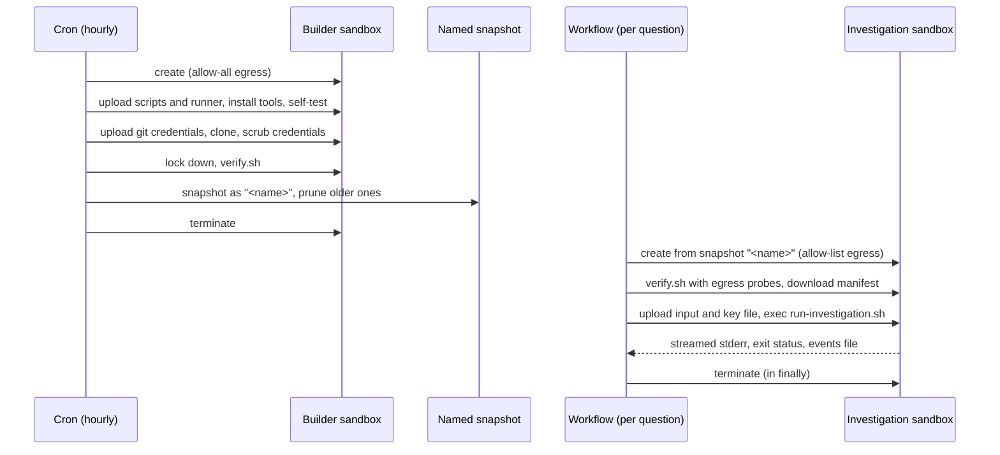

# How this project uses Render Sandboxes

This is a guided tour of the Sandbox integration: what each call is for, where it lives, and which parts you need in your own project. If you have never used the Sandbox API, run [`examples/hello-sandbox.ts`](../examples/hello-sandbox.ts) first. It does the whole round trip (create, wait, upload, exec, download, terminate) in about 70 lines, and everything below is built from the same calls.

Each section is labeled:

- **Essential**: any Sandbox integration that runs untrusted work needs this.
- **Hardening**: defense in depth for this project's threat model (an AI agent running shell commands next to an API key). Worth copying when your workload is similar; skippable when it isn't.
- **SDK gap**: code that fills something `@renderinc/sdk` 1.2.0 leaves to callers. Delete it when the SDK provides it.

## The lifecycle

The idea to take away: **expensive, privileged setup happens once, in a builder; every unit of work gets a fresh, unprivileged copy of the result.** Setup needs the network and git credentials; the work needs neither. Splitting them means the sandbox that runs untrusted commands never had those things.

## 1. Build once in a builder sandbox

**Essential.** [`buildSnapshot`](../src/sandbox/render/snapshot.ts) creates a builder sandbox with `allow-all` egress and a `timeoutSeconds` backstop, then drives it entirely through `upload` and `exec`:

1. Upload one tar of everything the sandbox needs: the scripts in [`sandbox-runtime/`](../sandbox-runtime) and the runner, which [`bundleRunner`](../src/sandbox/runner-bundle.ts) builds on the spot into one self-contained JavaScript file, packages included. The sandbox needs Node to run it, and nothing else: no npm, no `node_modules`.
2. Install tools with [`install-tools.sh`](../sandbox-runtime/install-tools.sh) and run the runner's `--self-test`.
3. Clone the repositories at exact commits.
4. Write a manifest of what was cloned, lock the filesystem down, verify, snapshot.

Two rules worth copying:

- **Orchestrate from the host, script inside the sandbox.** The order of steps, timeouts, and error handling live in TypeScript, where you can test them with a fake API ([`test/sandbox-render.test.ts`](../test/sandbox-render.test.ts)). Anything long or security-critical that runs inside is a real `.sh` file you can read, shellcheck, and test locally ([`test/sandbox-runtime.test.ts`](../test/sandbox-runtime.test.ts)).
- **Order steps by trust.** Third-party code (the tool installer, and the bundled packages during the self-test) runs *before* any secret is uploaded. A test asserts this ordering.
- **Ship artifacts, don't install in the sandbox.** Bundling on the host means the sandbox never runs a package manager: nothing to pin, no install scripts, and no registry access needed at build time.

**Hardening.** `install-tools.sh` works on images with or without root and apt, verifying checksums of anything it downloads. Detecting the privilege-drop tool (`setpriv`, `runuser`, or `su`) and creating the runner user with `useradd` or `adduser` serve the same purpose. If you control your base image, bake the tools in and delete most of this.

## 2. Snapshot by name, and prune

**Essential.** The builder is snapshotted with a stable name (`snapshotName` in [`config.ts`](../config.ts)), and investigation sandboxes are created with `snapshotName`, which resolves to the newest available snapshot with that name. That indirection is what lets the cron replace the snapshot without coordinating with the workflow.

[`pruneSnapshots`](../src/sandbox/render/snapshot.ts) keeps the newest two. One is not enough: a question that started restoring just before a new build finished must still find its snapshot. Pruning logs instead of throwing, because a failed prune shouldn't fail a successful build.

**Essential.** When no snapshot exists yet, `create` fails with `SandboxSnapshotNotFoundError` or `SandboxSnapshotNotReadyError`. [`openRenderSandbox`](../src/sandbox/render/sandbox.ts) turns those into `SnapshotUnavailableError`, and the workflow reports "the repository snapshot isn't ready yet" instead of a generic failure.

## 3. One fresh sandbox per unit of work

**Essential.** [`openRenderSandbox`](../src/sandbox/render/sandbox.ts) creates a new sandbox for every question, and [`investigateTask`](../src/tasks.ts) closes it in a `finally` block. Two safety nets cover a crash between those points: `timeoutSeconds` on `create` makes Render terminate the sandbox on its own, and `terminate` treats 404 as already terminated, so closing twice is harmless.

Reusing sandboxes would save the restore (about 15 seconds here), at the cost of one question's leftovers (files, processes, environment changes) leaking into the next. For untrusted work, take the fresh restore.

## 4. Grant the least network access

**Essential.** Investigation sandboxes use an `allow-list` policy with exactly one host: the model provider's API, read from the model's base URL in Pi's registry ([`investigateTask`](../src/tasks.ts)). The builder uses `allow-all` because it needs git hosts, and nodejs.org or GitHub releases when the base image lacks Node or ripgrep. It never runs the agent, and the only third-party code it runs (the tool installer and the runner's self-test) runs before any secret arrives.

Two details in `openRenderSandbox`:

- If the workspace rejects `allow-list` (400 or 422), the error says so and tells you how to choose another policy, instead of passing along a bare 400.
- If Render returns a sandbox with a different policy than requested, the sandbox is terminated rather than used. Never run with wider egress than you asked for.

The [design doc](design.md#known-residual-risk-dns) describes what the allow-list does not cover (DNS).

## 5. Verify before you trust

**Essential.** [`verify.sh`](../sandbox-runtime/verify.sh) runs on the builder before the snapshot *and* on every restored sandbox before it gets work. It fails unless the repositories match the manifest, no credentials survived, the repositories are read-only to the runner user, scratch is writable, and the runner passes its self-test. On restored sandboxes, the host also passes egress probes: one URL that must be blocked and one that must be reachable.

The point is to check the sandbox you actually got instead of trusting the steps that built it. A misconfigured snapshot fails loudly at verification instead of quietly running work with the wrong permissions.

**Hardening.** The memory-access probe confirms the runner's Node binary is execute-only, so commands the agent runs as the same user can't read the API key from the runner's memory through `/proc`. This matters only when untrusted code shares a sandbox with a secret.

## 6. Keep credentials short-lived

**Essential.** Git tokens exist only during the builder's clone step:

- They are uploaded as files (`/tmp/triage-stage/creds/<host>`), never put in a command, a URL, or an environment variable. Commands and environment variables show up in process listings, and URLs end up in `.git/config`.
- Git reads them through [`git-credential-staged.sh`](../sandbox-runtime/build/git-credential-staged.sh).
- [`scrub-credentials.sh`](../sandbox-runtime/build/scrub-credentials.sh) then fails the build if any token value appears in a git config, a credential store, or a repository's `.git`, and deletes the files. Both scripts live in a staging folder that is removed before the snapshot.

**Essential.** The model API key goes to each investigation sandbox the same way: as a file next to the run's input, which the runner deletes as soon as it has read it ([`runInvestigation`](../src/sandbox/render/sandbox.ts), [`run-investigation.sh`](../sandbox-runtime/run-investigation.sh)). Commands the agent runs get an environment built from an allowlist, so the key isn't in it.

## 7. Run work and get results back

**Essential.** [`runInvestigation`](../src/sandbox/render/sandbox.ts) shows the pattern for a long-running job:

1. `exec` a `mkdir` for a per-run folder, then `upload` the input and the key file into it.
2. `exec` the job script and stream its output. The script writes structured results to a file and its exit status to another.
3. `download` the results file.

**SDK gap.** If the exec stream drops, the job keeps running inside the sandbox, but the API can't reattach to it. So the host polls for the exit-status file until it appears or the sandbox stops. Writing results to files instead of relying on the stream is what makes that recovery possible.

**Hardening.** The results and exit-status files are written next to the run folder, not inside it, and owned by root. The runner user can't overwrite what the host will read.

## 8. Calling the API

**SDK gap.** [`SandboxClient`](../src/sandbox/render/client.ts) wraps the SDK client with what version 1.2.0 leaves to callers:

| Behavior | Why |
|---|---|
| Spacing requests out | The Sandbox API allows 100 requests a minute per workspace; the SDK doesn't throttle |
| Retrying 429 and 503 | The SDK surfaces them as errors |
| `waitRunning` | `create` returns while the sandbox is still `creating`, and there's no wait helper |
| Retrying 404 just after create | A new sandbox briefly answers 404 to `get` and `exec` |
| Collecting `exec` output | The SDK returns the raw event stream |

`examples/hello-sandbox.ts` has the minimal versions of the last three; you can skip throttling and 429 retries in a script that makes a handful of calls.

## 9. Develop without sandboxes

**Recommended.** Application code depends on the `Sandbox` interface in [`interface.ts`](../src/sandbox/interface.ts), not on Render's API. [`localSandboxes`](../src/sandbox/local.ts) implements it with plain child processes against local checkouts (no isolation), which is how the whole workflow runs on a laptop and how most tests run. Keep that seam in your own integration: it makes the cloud-only parts small and the rest fast to test.
